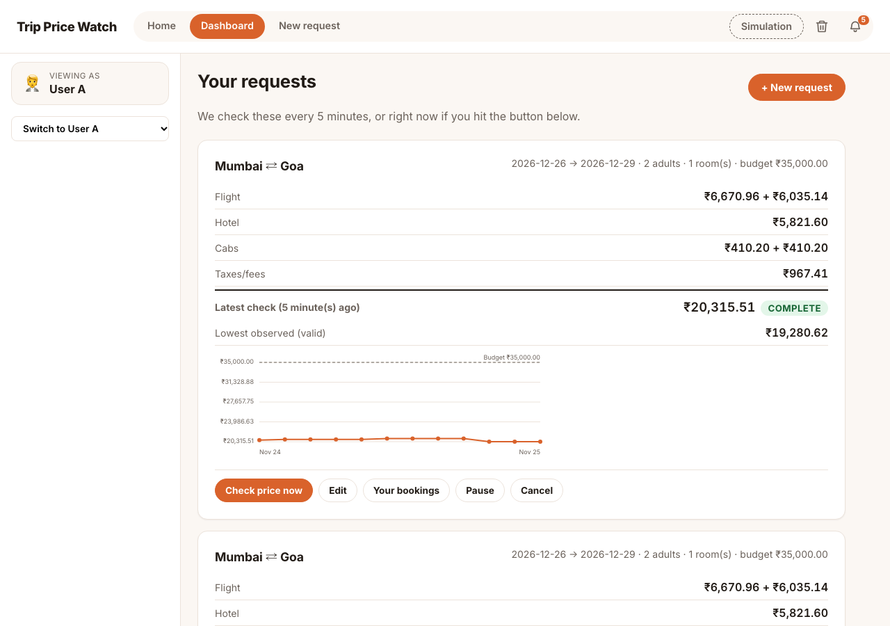
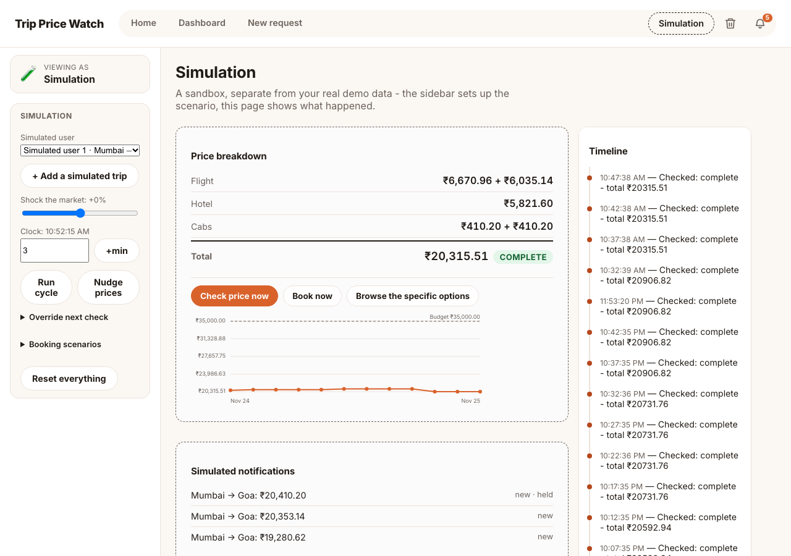
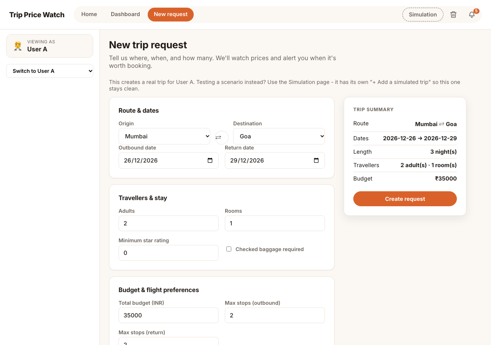

# Trip Price Watch & Booking


A take-home assignment for Tavora: a small product that watches the price of a
trip (flight + hotel + airport cab) for you, tells you when it drops into your
budget, and lets you approve a (simulated) booking.

**Live demo:** https://tavora-frontend-2ldl.onrender.com
Backend: https://tavora-backend-fm0b.onrender.com - it's on Render's free
tier, so if nobody's used it in the last 15 minutes, the first request takes
30-60 seconds to wake up. That's normal, not a bug.

## What it actually does

1. You create a trip request: where you're going, when, how many people, and
   your budget.
2. Every 5 minutes (or whenever you click "Check price now"), it looks up a
   real flight price, a real hotel price, and a cab price, and adds them up.
3. If the total drops to or below your budget, you get a notification.
4. You open the notification, it re-checks the price one more time (prices
   can move between the alert and now), and you explicitly approve the
   booking.
5. It "books" each piece (flight, hotel, cab) one at a time, and handles the
   messy cases on purpose: a hotel room disappearing mid-booking, a supplier
   that never responds, two people booking the same last room, the app
   restarting mid-booking. Nothing is swept under the rug - you can watch all
   of this happen live.

No real purchases happen anywhere. Everything booking-related is clearly
labelled as simulated.

## Screenshots

**Dashboard** - every trip you're watching, its current price, and a
price-history chart:



**Simulation page** - a sandbox for replaying every hard scenario on demand
(price drops, booking failures, last-room races) without waiting for a real
price to move:



**New trip request:**



## Running it yourself

You'll need Python 3.11+, Node 20+, and a local Postgres.

```bash
# Backend
cd backend
python -m venv .venv && source .venv/bin/activate
pip install -r requirements.txt
createdb tavora
cp .env.example .env   # fill in your own Postgres URL; Sabre/Hotelbeds keys are optional (see below)
alembic upgrade head
python scripts/seed.py   # creates the 3 demo users + their requests
uvicorn app.main:app --reload

# Frontend, in a second terminal
cd frontend
npm install
npm run dev
```

Open http://localhost:5173. Without real Sabre/Hotelbeds credentials, flights
and hotels fall back to clearly-labelled synthetic data - see
`docs/DATA_SOURCES.md` for exactly what's real vs. simulated and why.

## Where everything else is

This repo has to prove a lot of things a reviewer needs to check, so it's
split up rather than crammed into one file:

| Document | What's in it |
|---|---|
| `docs/METHODOLOGY_REPORT.md` | How I approached this, what I decided and why, trade-offs |
| `docs/HOW_IT_WORKS.md` | Architecture, data model, request-to-booking flow, API examples |
| `docs/DATA_SOURCES.md` | Which flight/hotel/cab data is real, which is simulated, and why |
| `docs/VERIFICATION_PACKAGE.md` | Tests, how to run them, the load test, a requirement-by-requirement checklist |
| `docs/DEMO_AND_HANDOVER.md` | Setup instructions, known issues, what's needed for production, AI-assistance disclosure |
| `docs/assignment.pdf` | The original brief |

`backend/scripts/seed.py` sets up the three required demo users. `reset.py`
puts everything back to that starting state if a demo session leaves things
messy.
