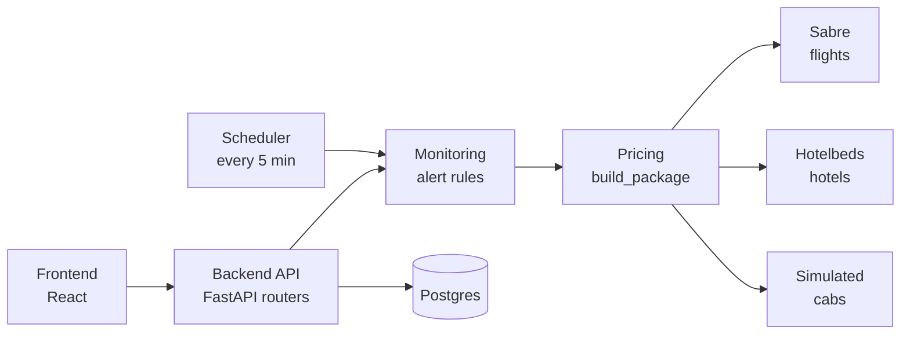
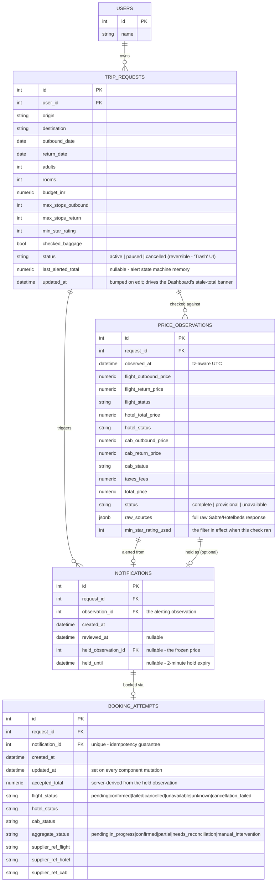
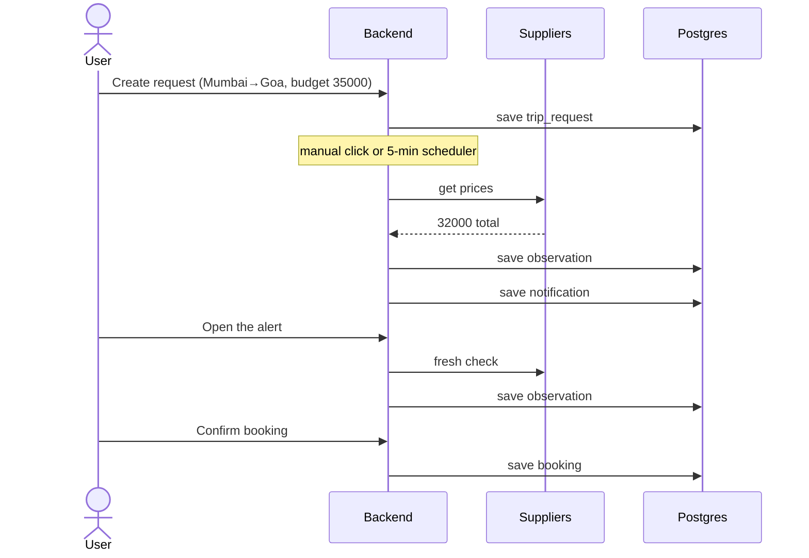

# How It Works

*Architecture, data model, request lifecycle, API contracts, and recovery
procedure for Trip Price Watch & Booking.*

## 1. Architecture



One FastAPI process (routers, scheduler, Simulation state all in it), one Postgres database, two real
sandbox suppliers plus one simulated. Deployed as two Render services (backend + static frontend build)
plus a managed Postgres instance, documented hosting restrictions in `docs/KNOWN_ISSUES_AND_PRODUCTION.md`.

**Example**: checking request #1 (Mumbai -> Goa) calls Frontend -> API -> Monitoring -> Pricing ->
Sabre (returns ₹13,200) + Hotelbeds (₹15,000) + simulated cabs (₹1,800) -> total ₹32,000, saved to
Postgres.

## 2. Data model

Five tables, all in `backend/app/models.py`:



`price_observations` is strictly **append-only** - history and "lowest observed valid total" always
come from real rows, never a reconstructed average.

**Example data - one real request, every field, in order:**

`users`

| id | name |
|---|---|
| 1 | User A |

`trip_requests`

| id | user_id | origin | destination | outbound_date | return_date | adults | rooms | budget_inr | max_stops_outbound | max_stops_return | min_star_rating | checked_baggage | status | last_alerted_total | updated_at |
|---|---|---|---|---|---|---|---|---|---|---|---|---|---|---|---|
| 1 | 1 | Mumbai | Goa | 2026-12-26 | 2026-12-29 | 2 | 1 | 35000 | 2 | 2 | 0 | false | active | 32000 | 2026-11-20T10:00:00+05:30 |

`price_observations`

| id | request_id | observed_at | flight_outbound_price | flight_return_price | flight_status | hotel_total_price | hotel_status | cab_outbound_price | cab_return_price | cab_status | taxes_fees | total_price | status |
|---|---|---|---|---|---|---|---|---|---|---|---|---|---|
| 101 | 1 | 2026-11-25T09:00:00+05:30 | 6600 | 6600 | complete | 15000 | complete | 900 | 900 | complete | 2000 | 32000 | complete |

32,000 ≤ the request's 35,000 budget → this observation triggers a notification.

`notifications`

| id | request_id | observation_id | created_at | reviewed_at | held_observation_id | held_until |
|---|---|---|---|---|---|---|
| 7 | 1 | 101 | 2026-11-25T09:00:05+05:30 | 2026-11-25T09:05:00+05:30 | 102 | 2026-11-25T09:07:00+05:30 |

`held_observation_id=102` points to a second, fresher observation taken on review (total 31,800) - the
hold freezes that number, not the original 32,000.

`booking_attempts`

| id | request_id | notification_id | accepted_total | flight_status | hotel_status | cab_status | aggregate_status | supplier_ref_flight | supplier_ref_hotel | supplier_ref_cab |
|---|---|---|---|---|---|---|---|---|---|---|
| 5 | 1 | 7 | 31800 | confirmed | confirmed | confirmed | confirmed | SIM-FLIGHT-a1b2c3d4 | SIM-HOTEL-e5f6a7b8 | SIM-CAB-c9d0e1f2 |

## 3. Request-to-booking sequence

Walked through with the same example as §2 (request #1, budget ₹35,000):



## 4. State transitions

**Package / component status** (`PriceObservation.status` and each
component's own status column):

```
unavailable  --(real call succeeds)-->  complete
unavailable  --(real call succeeds, partial data)-->  provisional   [schema-forward, not yet reachable]
```
Only `complete` can ever trigger a budget alert.

**Alert state machine** (`TripRequest.last_alerted_total`):

```
null (no active alert)
  --[complete, ≤ budget]--> ALERTED (notification created, last_alerted_total = total)
ALERTED
  --[complete, ≤ budget, ≥5% further below last_alerted_total]--> ALERTED (re-alert, notification created)
  --[complete, ≤ budget, <5% drop]--> ALERTED (no change, no notification)
  --[complete, > budget]--> null (silent reset, no notification)
  --[unavailable/provisional]--> ALERTED (unchanged either way)
```

**Booking component status** (per component, on a booking attempt; V4 adds
the three non-terminal/exceptional values):

```
pending --[attempted, succeeds]--> confirmed
pending --[attempted, forced/real failure]--> failed
pending --[attempted, inventory disappeared]--> unavailable
pending --[attempted, supplier response never resolves]--> unknown
confirmed --[a later component in the same booking fails]--> cancelled (compensated)
confirmed --[a later component fails, AND this compensation itself fails]--> cancellation_failed
pending --[never attempted - booking stopped before reaching it]--> pending (unchanged)
```

Only `reconcile()` can resolve `unknown` to `confirmed`/`failed` - nothing else moves it.

**Aggregate booking status**:
```
in_progress   - some components still "pending" (fresh, or stopped by a simulated restart)
confirmed     - every component is "confirmed"
partial       - at least one component is "cancelled"/"failed"/"unavailable", no "unknown", no "cancellation_failed"
needs_reconciliation - at least one component is "unknown" (overrides partial)
manual_intervention  - at least one component is "cancellation_failed" (overrides partial)
```
`book()` creates one `BookingAttempt` per notification (idempotency guard + DB unique constraint). A
later call on an `in_progress` row resumes from the first `pending` component (restart recovery,
no duplicate); on any other non-fresh row it just returns the existing result unchanged.

**Example**: booking #5 above has flight/hotel/cab all `confirmed` → aggregate `confirmed`. If the
hotel had failed instead, flight would be compensated to `cancelled`, cab left `pending`, and the
aggregate would read `partial`.

## 5. API contracts (full endpoint list, with real example payloads)

Full OpenAPI schema (every field, every type) is auto-generated at `/docs`. Every real product
endpoint, every one requiring `user_id` and ownership-scoped server-side except `GET /api/users`:

| Method | Path | Body | Returns |
|---|---|---|---|
| GET | `/api/users` | - | `User[]` |
| POST | `/api/requests` | `TripRequestCreate` | `TripRequestOut` |
| GET | `/api/requests?user_id=` | - | `TripRequestOut[]` |
| GET | `/api/requests/{id}?user_id=` | - | `TripRequestOut` |
| PATCH | `/api/requests/{id}?user_id=` | `TripRequestUpdate` | `TripRequestOut` |
| POST | `/api/requests/{id}/pause?user_id=` | - | `TripRequestOut` |
| POST | `/api/requests/{id}/cancel?user_id=` | - | `TripRequestOut` |
| POST | `/api/requests/{id}/reactivate?user_id=` | - | `TripRequestOut` |
| POST | `/api/requests/{id}/reset-to-default?user_id=` | - | `TripRequestOut` |
| GET | `/api/requests/{id}/observations?user_id=` | - | `PriceObservationOut[]` |
| POST | `/api/requests/{id}/check?user_id=` | - | `PriceObservationOut` |
| GET | `/api/notifications?user_id=` | - | `NotificationOut[]` |
| POST | `/api/notifications/{id}/review?user_id=` | - | `NotificationReviewOut` |
| POST | `/api/requests/{id}/book?user_id=` | `{notification_id}` | `BookingAttemptOut` |
| POST | `/api/requests/{id}/buy-now?user_id=` | - | `BookingAttemptOut` |
| GET | `/api/bookings/{id}?user_id=` | - | `BookingAttemptOut` |
| POST | `/api/bookings/{id}/reconcile?user_id=` | `{outcome}` | `BookingAttemptOut` |
| GET | `/api/requests/{id}/directory?user_id=` | - | `TripDirectoryOut` |
| GET | `/api/requests/{id}/story?user_id=` | - | `TripStoryOut` (legacy, see below) |
| GET | `/api/ops/partial-bookings?user_id=` | - | `BookingAttemptOut[]` |
| GET | `/api/ops/requests/{id}/timeline?user_id=` | - | `TimelineEventOut[]` |

Plus `/api/lab/*` - 14 Simulation-only endpoints (clock, clock/advance, override, fail-component,
cancel-failure, restart-after, book-now, shock-and-check, trigger-cycle, mutate-prices,
shared-room-scenario, log, log/clear, reset), never ownership-gated since they're reviewer/demo
tooling, not product surface - each one's exact replay command is in
`docs/VERIFICATION_PACKAGE.md` §2.

Real captured response shapes for the endpoints worth seeing in detail:

**`POST /api/requests/{id}/check?user_id={user_id}`** → `PriceObservationOut`
```json
{
  "id": 1, "request_id": 1,
  "observed_at": "2026-11-22T01:38:03.013423+05:30",
  "flight_outbound_price": 7492.0, "flight_return_price": 7186.0,
  "flight_status": "complete",
  "hotel_total_price": 16435.95, "hotel_status": "complete",
  "cab_outbound_price": 900.0, "cab_return_price": 900.0, "cab_status": "complete",
  "taxes_fees": 1645.7, "total_price": 34559.65, "status": "complete"
}
```

**`GET /api/notifications?user_id={user_id}`** → `NotificationOut[]` (itinerary, itemized total, quote status - enough to render a full alert card)
```json
[
  { "id": 7, "request_id": 1, "origin": "Mumbai", "destination": "Goa",
    "total_price": 20197.75, "quote_status": "complete",
    "created_at": "...", "reviewed_at": null,
    "held_observation_id": null, "held_until": null }
]
```

**`POST /api/notifications/{id}/review?user_id={user_id}`** → `NotificationReviewOut`
```json
{
  "notification": { "id": 1, "held_until": "2026-11-22T01:45:08+05:30", "...": "..." },
  "original_observation": { "total_price": 34559.65, "...": "..." },
  "current_observation": { "total_price": 34559.65, "...": "..." }
}
```

**`POST /api/requests/{id}/book?user_id={user_id}`** body `{"notification_id": 1}` → `BookingAttemptOut`
```json
{
  "id": 1, "request_id": 1, "notification_id": 1,
  "accepted_total": 34559.65,
  "flight_status": "confirmed", "hotel_status": "confirmed", "cab_status": "confirmed",
  "aggregate_status": "confirmed",
  "supplier_ref_flight": "SIM-FLIGHT-c7e4206a",
  "supplier_ref_hotel": "SIM-HOTEL-8b8d1906",
  "supplier_ref_cab": "SIM-CAB-b7747fd0"
}
```

**`POST /api/requests/{id}/buy-now?user_id={user_id}`** → same `BookingAttemptOut` shape. Checks, holds
regardless of budget, and books in one call - shares `book()`'s implementation, so all recovery behavior
above applies identically.

**`POST /api/lab/shock-and-check`** body `{"request_id": 1, "shock_fraction": 0.3}` → `PriceObservationOut`.
Simulation-only: moves one trip's market by an exact signed % (clamped ±60%) and re-checks in one call -
drives the Simulation page's "Shock the market" slider.

**A real partial-failure result** (forced via Simulation):
```json
{
  "flight_status": "cancelled", "hotel_status": "failed", "cab_status": "pending",
  "aggregate_status": "partial",
  "supplier_ref_flight": "SIM-FLIGHT-3deb52dc",
  "supplier_ref_hotel": null, "supplier_ref_cab": null
}
```

**A real supplier-timeout result, before reconciliation** (`POST /api/lab/fail-component`, `"outcome": "timeout"`):
```json
{
  "flight_status": "confirmed", "hotel_status": "unknown", "cab_status": "pending",
  "aggregate_status": "needs_reconciliation",
  "supplier_ref_flight": "SIM-FLIGHT-9c2063f1",
  "supplier_ref_hotel": null, "supplier_ref_cab": null
}
```
**`POST /api/bookings/{id}/reconcile?user_id={user_id}`** body
`{"outcome": "confirmed"}` resolves the above to:
```json
{
  "flight_status": "confirmed", "hotel_status": "confirmed", "cab_status": "confirmed",
  "aggregate_status": "confirmed",
  "supplier_ref_flight": "SIM-FLIGHT-9c2063f1",
  "supplier_ref_hotel": "SIM-HOTEL-0ec3c268", "supplier_ref_cab": "SIM-CAB-7b03bfdc"
}
```

**A real restart-resume result** (`POST /api/lab/restart-after` on flight, then `book()` called twice - same `id` both times):
```json
{ "id": 2, "flight_status": "confirmed", "hotel_status": "pending", "cab_status": "pending", "aggregate_status": "in_progress" }
```
```json
{ "id": 2, "flight_status": "confirmed", "hotel_status": "confirmed", "cab_status": "confirmed", "aggregate_status": "confirmed" }
```

**A real cancellation-failure result** (`fail-component` "fail" on hotel + `cancel-failure` on flight):
```json
{
  "flight_status": "cancellation_failed", "hotel_status": "failed", "cab_status": "pending",
  "aggregate_status": "manual_intervention",
  "supplier_ref_flight": "SIM-FLIGHT-53cb3232"
}
```
`supplier_ref_flight` stays present - a failed compensation never erases what it tried to cancel.

**`GET /api/ops/requests/{id}/timeline?user_id={user_id}`** → merged event feed
```json
[
  { "type": "observation", "at": "...", "summary": "Checked: complete - total ₹34559.65" },
  { "type": "notification", "at": "...", "summary": "Alert created" },
  { "type": "notification", "at": "...", "summary": "Offer reviewed" },
  { "type": "booking", "at": "...", "summary": "Booking attempt: partial (flight=cancelled, hotel=failed, cab=pending)" }
]
```

**`GET /api/requests/{id}/directory?user_id={user_id}`** → what **Your Bookings** reads. Always live -
queries the same candidate tables `pricing.py` does, never a snapshot of one past check.
```json
{
  "outbound_flight_candidates": [
    { "carrier_code": "6E", "carrier_name": "IndiGo", "flight_number": 2031,
      "departure_time": "08:15", "arrival_time": "09:40", "stops": 0,
      "price_inr": 6088.88, "selected": true },
    { "carrier_code": "UK", "...": "...", "price_inr": 6412.0, "selected": false }
  ],
  "return_flight_candidates": [ "...same shape..." ],
  "hotel_candidates": [
    { "hotel_name": "Calangute Villae By Urban Getaway", "category_name": "3 STARS",
      "star_rating": 3, "room_description": "...", "price_inr": 6152.2, "selected": true },
    { "hotel_name": "The Zuri White Sands Goa Resort & Casino", "star_rating": 5,
      "price_inr": 56846.1, "selected": false }
  ],
  "cab_candidates": [
    { "vendor_name": "CityLink Transfers", "vehicle_class": "Sedan",
      "passenger_capacity": 4, "luggage_capacity": 2, "distance_km": 30.0,
      "per_km_rate_inr": 14.0, "price_per_leg_inr": 420.0, "selected": true },
    { "vendor_name": "Horizon Tempo Services", "vehicle_class": "Tempo Traveller",
      "per_km_rate_inr": 24.0, "price_per_leg_inr": 720.0, "selected": false }
  ]
}
```
`selected` marks the cheapest eligible option per list - exactly what `pricing.py` would pick right now.
UI sort options are pure client-side re-sorts of this same list.

**`GET /api/requests/{id}/story?user_id={user_id}`** - legacy, superseded by `/directory` above. Reads
`PriceObservation.raw_sources`, which is only a full payload for a request edited off the three demo
routes (live-call fallback); for the cached/synthetic path the demo routes use, it returns little or
nothing. Still covered by `tests/test_story.py`; the frontend no longer calls it.

Every mutating endpoint requires `user_id` and is ownership-scoped server-side (`app/ownership.py`) - a
request/notification/booking belonging to someone else returns a plain 404, never a 403.

## 6. Operator recovery procedure

1. Open the **Dashboard** as the owning user - a **"Needs attention"** card appears above the request
   list whenever a booking's `aggregate_status != "confirmed"` (hidden otherwise).
2. Click **View event timeline** - every observation/notification/booking event for that request, in order.
3. Read each component's status: `cancelled` = booked then compensated · `cancellation_failed` = still
   genuinely confirmed with the supplier, compensation itself failed · `failed`/`unavailable` = never
   booked · `unknown` = outcome never confirmed · `pending` = never attempted.
4. **`needs_reconciliation`** (a component is `unknown`): use the booking result page's reconcile action
   to record what the supplier actually did - no automatic resolution, by design.
5. **`manual_intervention`** (a compensating cancellation failed): the component is still genuinely
   confirmed with its supplier (reference preserved) - needs a human to cancel it out-of-band; never
   retried automatically.
6. **`in_progress`** (interrupted mid-booking): booking the same offer again resumes from the first
   unattempted component, no duplicate.
