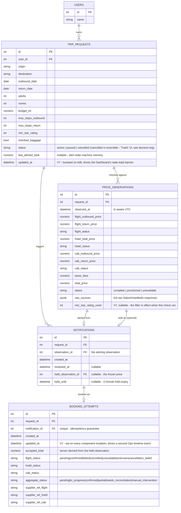
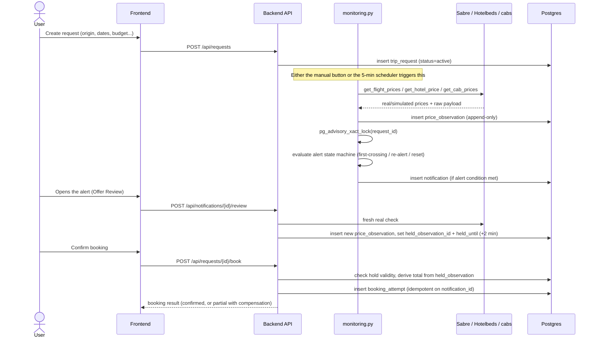

# How It Works

*Architecture, data model, request lifecycle, API contracts, and recovery
procedure for Trip Price Watch & Booking.*

## 1. Architecture

```mermaid
flowchart LR
    subgraph Browser
        FE[React + Vite + TS<br/>Home / Dashboard / New Request /<br/>Your Bookings / Offer Review / Booking Result / Simulation<br/>(Notifications and Operations are folded into the<br/>header bell and the Dashboard's "Needs attention", not separate pages)]
    end

    subgraph Backend [FastAPI - single process]
        API[Routers<br/>requests · check · notifications · booking · ops · lab]
        MON[monitoring.py<br/>alert state machine]
        PRICE[pricing.py<br/>build_package]
        SCHED[scheduler.py<br/>APScheduler, 5-min cycle]
        SIM[sim_clock.py / sim_controller.py<br/>Simulation backing state]
    end

    DB[(Postgres<br/>users · trip_requests ·<br/>price_observations ·<br/>notifications · booking_attempts)]

    SABRE[Sabre Dev Studio<br/>real sandbox - flights]
    HB[Hotelbeds Apitude<br/>real sandbox - hotels]
    CAB[Simulated cabs<br/>no real source exists]

    FE -- HTTPS/JSON --> API
    API --> MON --> PRICE
    SCHED --> MON
    PRICE --> SABRE
    PRICE --> HB
    PRICE --> CAB
    API --> DB
    API --> SIM
```

Deployed as two Render services (FastAPI backend, static Vite build) plus a
managed Postgres instance — see `docs/internal/decision-log.md`'s deploy entry for the
real setup detail (CORS/API-base-URL wiring, the free-tier limitations that
apply).

## 2. Data model

Five tables, all in `backend/app/models.py`:



`price_observations` is strictly **append-only** — never updated, never
deleted — so the price-history view and "lowest observed valid total" are
always derivable from real rows, never reconstructed from an average or a
guess.

## 3. Request-to-booking sequence



## 4. State transitions

**Package / component status** (`PriceObservation.status` and each
component's own status column):

```
unavailable  --(real call succeeds)-->  complete
unavailable  --(real call succeeds, partial data)-->  provisional   [schema-forward, not yet reachable]
```
Only `complete` can ever trigger a budget alert.

**Alert state machine** (`TripRequest.last_alerted_total`):

```
null (no active alert)
  --[complete, ≤ budget]--> ALERTED (notification created, last_alerted_total = total)
ALERTED
  --[complete, ≤ budget, ≥5% further below last_alerted_total]--> ALERTED (re-alert, notification created)
  --[complete, ≤ budget, <5% drop]--> ALERTED (no change, no notification)
  --[complete, > budget]--> null (silent reset, no notification)
  --[unavailable/provisional]--> ALERTED (unchanged either way)
```

**Booking component status** (per component, on a booking attempt; V4 adds
the three non-terminal/exceptional values):

```
pending --[attempted, succeeds]--> confirmed
pending --[attempted, forced/real failure]--> failed
pending --[attempted, inventory disappeared]--> unavailable
pending --[attempted, supplier response never resolves]--> unknown
confirmed --[a later component in the same booking fails]--> cancelled (compensated)
confirmed --[a later component fails, AND this compensation itself fails]--> cancellation_failed
pending --[never attempted - booking stopped before reaching it]--> pending (unchanged)
```

`unknown` is the only non-terminal status a component can be left in - it
blocks the whole booking until `POST /api/bookings/{id}/reconcile` resolves
it to either `confirmed` or `failed`.

**Aggregate booking status**:
```
in_progress   - some components still "pending" (fresh, or stopped by a simulated restart)
confirmed     - every component is "confirmed"
partial       - at least one component is "cancelled"/"failed"/"unavailable", no "unknown", no "cancellation_failed"
needs_reconciliation - at least one component is "unknown" (overrides partial)
manual_intervention  - at least one component is "cancellation_failed" (overrides partial)
```
`book()` only ever creates one `BookingAttempt` row per notification
(idempotency guard + DB `unique` constraint). A later `book()` call on an
`in_progress` row *resumes* it (continues from the first `pending`
component - this is how a simulated process restart is recovered from
without a duplicate booking); a later call on any other non-fresh row just
returns it unchanged - only `reconcile()` can move a `needs_reconciliation`
row forward.

## 5. API contracts (selected, with real example payloads)

Full OpenAPI schema is auto-generated by FastAPI at `/docs` on the running
backend. Key endpoints, with real response shapes captured during actual
testing:

**`POST /api/requests/{id}/check?user_id={user_id}`** → `PriceObservationOut`
```json
{
  "id": 1, "request_id": 1,
  "observed_at": "2026-11-22T01:38:03.013423+05:30",
  "flight_outbound_price": 7492.0, "flight_return_price": 7186.0,
  "flight_status": "complete",
  "hotel_total_price": 16435.95, "hotel_status": "complete",
  "cab_outbound_price": 900.0, "cab_return_price": 900.0, "cab_status": "complete",
  "taxes_fees": 1645.7, "total_price": 34559.65, "status": "complete"
}
```

**`GET /api/notifications?user_id={user_id}`** → `NotificationOut[]` (V7:
now carries enough to render a real alert card, per Sec. 07 - "itinerary,
itemized total... quote status" - not just observation time)
```json
[
  { "id": 7, "request_id": 1, "origin": "Mumbai", "destination": "Goa",
    "total_price": 20197.75, "quote_status": "complete",
    "created_at": "...", "reviewed_at": null,
    "held_observation_id": null, "held_until": null }
]
```

**`POST /api/notifications/{id}/review?user_id={user_id}`** → `NotificationReviewOut`
```json
{
  "notification": { "id": 1, "held_until": "2026-11-22T01:45:08+05:30", "...": "..." },
  "original_observation": { "total_price": 34559.65, "...": "..." },
  "current_observation": { "total_price": 34559.65, "...": "..." }
}
```

**`POST /api/requests/{id}/book?user_id={user_id}`** body `{"notification_id": 1}` → `BookingAttemptOut`
```json
{
  "id": 1, "request_id": 1, "notification_id": 1,
  "accepted_total": 34559.65,
  "flight_status": "confirmed", "hotel_status": "confirmed", "cab_status": "confirmed",
  "aggregate_status": "confirmed",
  "supplier_ref_flight": "SIM-FLIGHT-c7e4206a",
  "supplier_ref_hotel": "SIM-HOTEL-8b8d1906",
  "supplier_ref_cab": "SIM-CAB-b7747fd0"
}
```

**A real partial-failure result** (forced via Simulation):
```json
{
  "flight_status": "cancelled", "hotel_status": "failed", "cab_status": "pending",
  "aggregate_status": "partial",
  "supplier_ref_flight": "SIM-FLIGHT-3deb52dc",
  "supplier_ref_hotel": null, "supplier_ref_cab": null
}
```

**A real supplier-timeout result, before reconciliation** (forced via
`POST /api/lab/fail-component` with `"outcome": "timeout"`, captured live
against a running local server):
```json
{
  "flight_status": "confirmed", "hotel_status": "unknown", "cab_status": "pending",
  "aggregate_status": "needs_reconciliation",
  "supplier_ref_flight": "SIM-FLIGHT-9c2063f1",
  "supplier_ref_hotel": null, "supplier_ref_cab": null
}
```
**`POST /api/bookings/{id}/reconcile?user_id={user_id}`** body
`{"outcome": "confirmed"}` resolves the above to:
```json
{
  "flight_status": "confirmed", "hotel_status": "confirmed", "cab_status": "confirmed",
  "aggregate_status": "confirmed",
  "supplier_ref_flight": "SIM-FLIGHT-9c2063f1",
  "supplier_ref_hotel": "SIM-HOTEL-0ec3c268", "supplier_ref_cab": "SIM-CAB-7b03bfdc"
}
```

**A real restart-resume result** (forced via `POST /api/lab/restart-after`
with `"component": "flight"`, then `book()` called twice on the same
notification - same `id` both times, captured live):
```json
{ "id": 2, "flight_status": "confirmed", "hotel_status": "pending", "cab_status": "pending", "aggregate_status": "in_progress" }
```
```json
{ "id": 2, "flight_status": "confirmed", "hotel_status": "confirmed", "cab_status": "confirmed", "aggregate_status": "confirmed" }
```

**A real cancellation-failure result** (forced via `fail-component`
`"outcome": "fail"` on hotel plus `POST /api/lab/cancel-failure` on flight):
```json
{
  "flight_status": "cancellation_failed", "hotel_status": "failed", "cab_status": "pending",
  "aggregate_status": "manual_intervention",
  "supplier_ref_flight": "SIM-FLIGHT-53cb3232"
}
```
Note `supplier_ref_flight` is still present - a failed compensation never
erases what it was trying to cancel.

**`GET /api/ops/requests/{id}/timeline?user_id={user_id}`** → merged event feed
```json
[
  { "type": "observation", "at": "...", "summary": "Checked: complete - total ₹34559.65" },
  { "type": "notification", "at": "...", "summary": "Alert created" },
  { "type": "notification", "at": "...", "summary": "Offer reviewed" },
  { "type": "booking", "at": "...", "summary": "Booking attempt: partial (flight=cancelled, hotel=failed, cab=pending)" }
]
```

**`GET /api/requests/{id}/directory?user_id={user_id}`** → what **Your
Bookings** actually reads. Always live - the real candidate tables queried
the same way `pricing.py` does, not a snapshot of one past check - so
hotels/cabs stay correct now that the live pricing path reads
cached/synthetic data instead of a full raw Sabre/Hotelbeds payload (see
`docs/internal/decision-log.md`'s synthetic-directories entry):
```json
{
  "outbound_flight_candidates": [
    { "carrier_code": "6E", "carrier_name": "IndiGo", "flight_number": 2031,
      "departure_time": "08:15", "arrival_time": "09:40", "stops": 0,
      "price_inr": 6088.88, "selected": true },
    { "carrier_code": "UK", "...": "...", "price_inr": 6412.0, "selected": false }
  ],
  "return_flight_candidates": [ "...same shape..." ],
  "hotel_candidates": [
    { "hotel_name": "Calangute Villae By Urban Getaway", "category_name": "3 STARS",
      "star_rating": 3, "room_description": "...", "price_inr": 6152.2, "selected": true },
    { "hotel_name": "The Zuri White Sands Goa Resort & Casino", "star_rating": 5,
      "price_inr": 56846.1, "selected": false }
  ],
  "cab_candidates": [
    { "vendor_name": "CityLink Transfers", "vehicle_class": "Sedan",
      "passenger_capacity": 4, "luggage_capacity": 2, "distance_km": 30.0,
      "per_km_rate_inr": 14.0, "price_per_leg_inr": 420.0, "selected": true },
    { "vendor_name": "Horizon Tempo Services", "vehicle_class": "Tempo Traveller",
      "per_km_rate_inr": 24.0, "price_per_leg_inr": 720.0, "selected": false }
  ]
}
```
`selected` marks the cheapest eligible option in each already-sorted list -
exactly what `pricing.py` would pick for a real check right now. Sort
options in the UI (star rating, stops, seats, luggage space, depending on
the tab) are pure client-side re-sorts of this same list.

**`GET /api/requests/{id}/story?user_id={user_id}`** (V6) - **legacy,
superseded by `/directory` above.** Extracts candidates from
`PriceObservation.raw_sources`, which only ever gets a full real
Sabre/Hotelbeds payload worth parsing for a request edited off the three
demo routes (so pricing falls back to a live supplier call) - for the
cached/synthetic path the three demo routes actually use, `raw_sources`
is now just a thin `{"synthetic_carrier": ...}` / `{"cached_hotel_name":
...}` marker, so this endpoint's extraction silently returns little or
nothing for them. Kept in the codebase and still covered by
`tests/test_story.py` (which tests the extraction functions directly
against real raw-payload fixtures, not this live gap), but the frontend no
longer calls it.

Every mutating endpoint requires `user_id` and is ownership-scoped
server-side (`app/ownership.py`) — a request/notification/booking that
exists but belongs to someone else returns a plain 404, not a 403, so
existence itself isn't leaked.

## 6. Operator recovery procedure

1. Open the **Dashboard** as the owning mock user — a **"Needs attention"**
   card appears above the request list whenever any of that user's
   bookings has `aggregate_status != "confirmed"` (stays hidden otherwise,
   rather than a permanent nav tab for a case that's usually empty). The
   underlying `/api/ops/*` endpoints this reads from are unchanged.
2. Click **View event timeline** on the stuck booking — shows every
   observation/notification/booking event for that request, in order, so
   it's clear exactly what happened and when (not just the final state).
3. Read each component's individual status: `cancelled` means it
   successfully booked and was then compensated; `cancellation_failed`
   means it's still genuinely confirmed with its supplier but the
   compensation attempt itself failed; `failed`/`unavailable` mean it never
   booked; `unknown` means its outcome was never confirmed; `pending` means
   it was never attempted because booking stopped before reaching it.
4. **For `aggregate_status = "needs_reconciliation"`** (a component is
   `unknown`): open the booking's result page and use the reconcile action
   to record whether the supplier actually booked it or not - the only way
   this state resolves. There is no automatic resolution, by design: an
   unknown outcome must be confirmed against the real supplier (or, here,
   decided by the operator), never guessed.
5. **For `aggregate_status = "manual_intervention"`** (a compensating
   cancellation itself failed): the flagged component is still genuinely
   confirmed with its supplier (its reference is preserved, not erased) and
   needs a human to actually cancel it out-of-band - this prototype
   correctly refuses to claim a rollback that didn't happen, but doesn't
   retry the cancellation automatically.
6. **For `aggregate_status = "in_progress"`** (the process was interrupted
   mid-booking): simply booking the same offer again resumes it from the
   first unattempted component - it will not create a duplicate.
