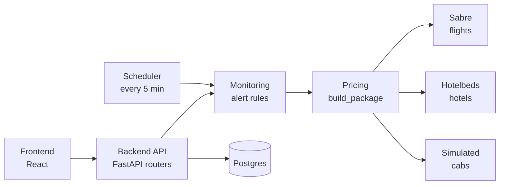
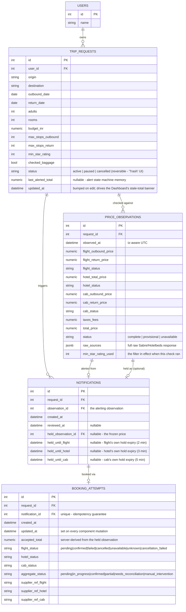
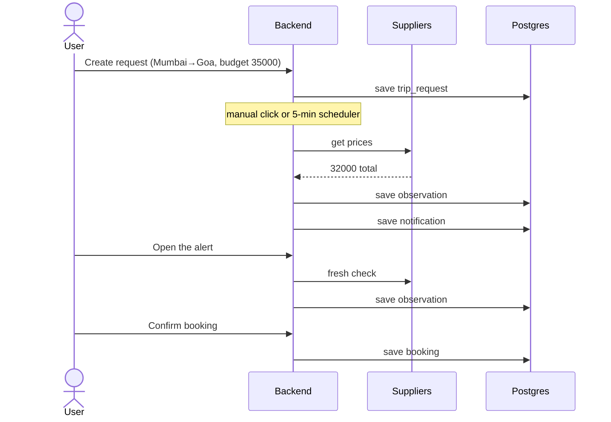

# How It Works

*Architecture, data model, request lifecycle, API contracts, and recovery
procedure for Trip Price Watch & Booking.*

## 1. Architecture



One FastAPI process (routers, scheduler, Simulation state all in it), one Postgres database, two real
sandbox suppliers plus one simulated. Deployed as two Render services (backend + static frontend build)
plus a managed Postgres instance, documented hosting restrictions in `docs/KNOWN_ISSUES_AND_PRODUCTION.md`.

**Example**: checking request #1 (Mumbai -> Goa) calls Frontend -> API -> Monitoring -> Pricing ->
Sabre (returns ₹13,200) + Hotelbeds (₹15,000) + simulated cabs (₹1,800) -> total ₹32,000, saved to
Postgres.

## 2. Data model

Five tables, all in `backend/app/models.py`:



`price_observations` is strictly **append-only** - history and "lowest observed valid total" always
come from real rows, never a reconstructed average.

**Example data - one real request, every field, in order:**

`users`

| id | name |
|---|---|
| 1 | User A |

`trip_requests`

| id | user_id | origin | destination | outbound_date | return_date | adults | rooms | budget_inr | max_stops_outbound | max_stops_return | min_star_rating | checked_baggage | status | last_alerted_total | updated_at |
|---|---|---|---|---|---|---|---|---|---|---|---|---|---|---|---|
| 1 | 1 | Mumbai | Goa | 2026-12-26 | 2026-12-29 | 2 | 1 | 35000 | 2 | 2 | 0 | false | active | 32000 | 2026-11-20T10:00:00+05:30 |

`price_observations`

| id | request_id | observed_at | flight_outbound_price | flight_return_price | flight_status | hotel_total_price | hotel_status | cab_outbound_price | cab_return_price | cab_status | taxes_fees | total_price | status |
|---|---|---|---|---|---|---|---|---|---|---|---|---|---|
| 101 | 1 | 2026-11-25T09:00:00+05:30 | 6600 | 6600 | complete | 15000 | complete | 900 | 900 | complete | 2000 | 32000 | complete |

32,000 ≤ the request's 35,000 budget → this observation triggers a notification.

`notifications`

| id | request_id | observation_id | created_at | reviewed_at | held_observation_id | held_until_flight | held_until_hotel | held_until_cab |
|---|---|---|---|---|---|---|---|---|
| 7 | 1 | 101 | 2026-11-25T09:00:05+05:30 | 2026-11-25T09:05:00+05:30 | 102 | 2026-11-25T09:07:00+05:30 | 2026-11-25T09:08:00+05:30 | 2026-11-25T09:10:00+05:30 |

`held_observation_id=102` points to a second, fresher observation taken on review (total 31,800) - the
hold freezes that number, not the original 32,000. Flight's hold (2 min) expires first, then hotel's
(3 min), then cab's (5 min) - booking is rejected the moment any one of the three passes, naming
which component specifically.

`booking_attempts`

| id | request_id | notification_id | accepted_total | flight_status | hotel_status | cab_status | aggregate_status | supplier_ref_flight | supplier_ref_hotel | supplier_ref_cab |
|---|---|---|---|---|---|---|---|---|---|---|
| 5 | 1 | 7 | 31800 | confirmed | confirmed | confirmed | confirmed | SIM-FLIGHT-a1b2c3d4 | SIM-HOTEL-e5f6a7b8 | SIM-CAB-c9d0e1f2 |

## 3. Request-to-booking sequence

Walked through with the same example as §2 (request #1, budget ₹35,000):



## 4. State transitions

**Package / component status** (`PriceObservation.status` and each
component's own status column):

```
unavailable  --(real call succeeds)-->  complete
timeout      --(Simulation's price-check-timeout lever; real supplier takes too long)-->  one component stays "timeout", the package as a whole is "provisional"
```
Only `complete` can ever trigger a budget alert.

**Alert state machine** (`TripRequest.last_alerted_total`):

```
null (no active alert)
  --[complete, ≤ budget]--> ALERTED (notification created, last_alerted_total = total)
ALERTED
  --[complete, ≤ budget, ≥5% further below last_alerted_total]--> ALERTED (re-alert, notification created)
  --[complete, ≤ budget, <5% drop]--> ALERTED (no change, no notification)
  --[complete, > budget]--> null (silent reset, no notification)
  --[unavailable/provisional]--> ALERTED (unchanged either way)
```

**Booking component status** (per component, on a booking attempt; V4 adds
the three non-terminal/exceptional values):

```
pending --[attempted, succeeds]--> confirmed
pending --[attempted, forced/real failure]--> failed
pending --[attempted, inventory disappeared]--> unavailable
pending --[attempted, supplier response never resolves]--> unknown
confirmed --[a later component in the same booking fails]--> cancelled (compensated)
confirmed --[a later component fails, AND this compensation itself fails]--> cancellation_failed
pending --[never attempted - booking stopped before reaching it]--> pending (unchanged)
```

Only `reconcile()` can resolve `unknown` to `confirmed`/`failed` - nothing else moves it.

**Aggregate booking status**:
```
in_progress   - some components still "pending" (fresh, or stopped by a simulated restart)
confirmed     - every component is "confirmed"
partial       - at least one component is "cancelled"/"failed"/"unavailable", no "unknown", no "cancellation_failed"
needs_reconciliation - at least one component is "unknown" (overrides partial)
manual_intervention  - at least one component is "cancellation_failed" (overrides partial)
```
`book()` creates one `BookingAttempt` per notification (idempotency guard + DB unique constraint). A
later call on an `in_progress` row resumes from the first `pending` component (restart recovery,
no duplicate); on any other non-fresh row it just returns the existing result unchanged.

**Example**: booking #5 above has flight/hotel/cab all `confirmed` → aggregate `confirmed`. If the
hotel had failed instead, flight would be compensated to `cancelled`, cab left `pending`, and the
aggregate would read `partial`.

## 5. API contracts (full endpoint list, with real example payloads)

Full OpenAPI schema (every field, every type) is auto-generated at `/docs`. Every real product
endpoint, every one requiring `user_id` and ownership-scoped server-side except `GET /api/users`:

| Method | Path | Body | Returns |
|---|---|---|---|
| GET | `/api/users` | - | `User[]` |
| POST | `/api/requests` | `TripRequestCreate` | `TripRequestOut` |
| GET | `/api/requests?user_id=` | - | `TripRequestOut[]` |
| GET | `/api/requests/{id}?user_id=` | - | `TripRequestOut` |
| PATCH | `/api/requests/{id}?user_id=` | `TripRequestUpdate` | `TripRequestOut` |
| POST | `/api/requests/{id}/pause?user_id=` | - | `TripRequestOut` |
| POST | `/api/requests/{id}/cancel?user_id=` | - | `TripRequestOut` |
| POST | `/api/requests/{id}/reactivate?user_id=` | - | `TripRequestOut` |
| POST | `/api/requests/{id}/reset-to-default?user_id=` | - | `TripRequestOut` |
| GET | `/api/requests/{id}/observations?user_id=&limit=&offset=` | - | `PriceObservationOut[]` (paginated, default limit 50, max 200) |
| POST | `/api/requests/{id}/check?user_id=` | - | `PriceObservationOut` |
| GET | `/api/notifications?user_id=` | - | `NotificationOut[]` |
| POST | `/api/notifications/{id}/review?user_id=` | - | `NotificationReviewOut` |
| POST | `/api/requests/{id}/book?user_id=` | `{notification_id}` | `BookingAttemptOut` |
| POST | `/api/requests/{id}/buy-now?user_id=` | - | `BookingAttemptOut` |
| GET | `/api/bookings/{id}?user_id=` | - | `BookingAttemptOut` |
| POST | `/api/bookings/{id}/reconcile?user_id=` | `{outcome}` | `BookingAttemptOut` |
| GET | `/api/requests/{id}/directory?user_id=` | - | `TripDirectoryOut` |
| GET | `/api/requests/{id}/story?user_id=` | - | `TripStoryOut` (legacy, see below) |
| GET | `/api/ops/partial-bookings?user_id=` | - | `BookingAttemptOut[]` |
| GET | `/api/ops/requests/{id}/timeline?user_id=&limit=&offset=` | - | `TimelineEventOut[]` (paginated, default limit 100, max 500 - most-recent-first, `offset` pages further into the past) |

Plus `/api/lab/*` - 16 Simulation-only endpoints (clock, clock/advance, override, fail-component,
cancel-failure, price-check-timeout, restart-after, book-now, shock-and-check, trigger-cycle,
mutate-prices, shared-room-scenario [GET+POST], log, log/clear, reset), never ownership-gated since
they're reviewer/demo tooling, not product surface - each one's exact replay command is in
`docs/VERIFICATION_PACKAGE.md` §2.

Behavior notes for the endpoints whose response *shape* is straightforward (see the table above and
`/docs` for exact fields) but whose response *content* depends on which scenario produced it:

- **`POST /api/requests/{id}/check`** - itemized flight/hotel/cab prices, taxes/fees, a total, and
  one overall `status` (`complete`/`provisional`/`unavailable`).
- **`GET /api/notifications`** - one entry per active request at most (the latest alert; see §4 of
  `VERIFICATION_PACKAGE.md`), itinerary + itemized total + quote status, enough to render a full
  alert card without a second call.
- **`POST /api/notifications/{id}/review`** - re-runs a real check and returns both the *original*
  alerting price and the *current* fresh one side by side, plus the new per-component hold
  deadlines (§2's ERD) if the fresh check came back complete.
- **A booking's `aggregate_status`** reflects exactly what happened to each component -
  `confirmed` (all three), `partial` (one failed, the rest compensated/cancelled),
  `needs_reconciliation` (a component came back `unknown` after a forced timeout, until
  `/bookings/{id}/reconcile` resolves it), `in_progress` (a simulated restart stopped mid-loop;
  calling `book()` again with the same notification resumes it, same booking `id`), or
  `manual_intervention` (a compensating cancellation itself failed - the original supplier ref is
  deliberately never erased).
- **`GET /api/ops/requests/{id}/timeline`** - a merged, time-sorted feed of observation/notification/
  booking events for one request, each a `{type, at, summary}` triple.
- **`GET /api/requests/{id}/directory`** - what **Your Bookings** reads: always a live re-query of
  the same candidate tables `pricing.py` itself picks from (flight/hotel/cab option lists, each
  entry flagged `selected` if it's the one `pricing.py` would currently choose), never a snapshot of
  one past check.
- **`GET /api/requests/{id}/story`** - legacy, superseded by `/directory` above; still covered by
  `tests/test_story.py` but the frontend no longer calls it.

Every mutating endpoint requires `user_id` and is ownership-scoped server-side (`app/ownership.py`) - a
request/notification/booking belonging to someone else returns a plain 404, never a 403.

## 6. Operator recovery procedure

1. Open the **Dashboard** as the owning user - a **"Needs attention"** card appears above the request
   list whenever a booking's `aggregate_status != "confirmed"` (hidden otherwise).
2. Click **View event timeline** - every observation/notification/booking event for that request, in order.
3. Read each component's status: `cancelled` = booked then compensated · `cancellation_failed` = still
   genuinely confirmed with the supplier, compensation itself failed · `failed`/`unavailable` = never
   booked · `unknown` = outcome never confirmed · `pending` = never attempted.
4. **`needs_reconciliation`** (a component is `unknown`): use the booking result page's reconcile action
   to record what the supplier actually did - no automatic resolution, by design.
5. **`manual_intervention`** (a compensating cancellation failed): the component is still genuinely
   confirmed with its supplier (reference preserved) - needs a human to cancel it out-of-band; never
   retried automatically.
6. **`in_progress`** (interrupted mid-booking): booking the same offer again resumes from the first
   unattempted component, no duplicate.
