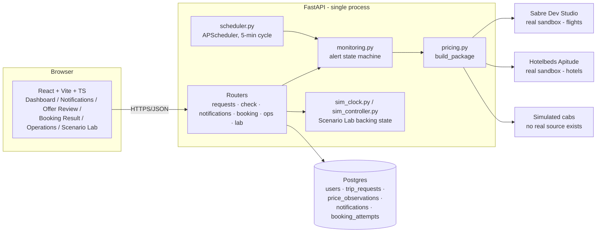
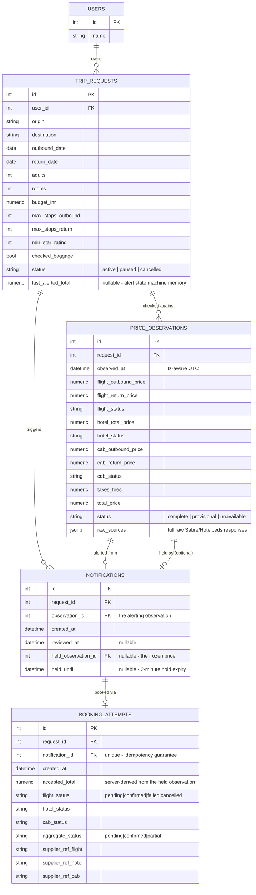
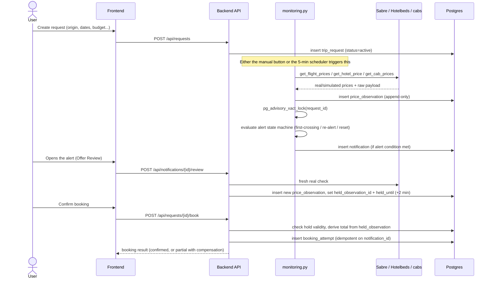

# How It Works

*Architecture, data model, request lifecycle, API contracts, and recovery
procedure for Trip Price Watch & Booking.*

## 1. Architecture



Deployed as two Render services (FastAPI backend, static Vite build) plus a
managed Postgres instance — see `docs/DECISIONS.md`'s deploy entry for the
real setup detail (CORS/API-base-URL wiring, the free-tier limitations that
apply).

## 2. Data model

Five tables, all in `backend/app/models.py`:



`price_observations` is strictly **append-only** — never updated, never
deleted — so the price-history view and "lowest observed valid total" are
always derivable from real rows, never reconstructed from an average or a
guess.

## 3. Request-to-booking sequence



## 4. State transitions

**Package / component status** (`PriceObservation.status` and each
component's own status column):

```
unavailable  --(real call succeeds)-->  complete
unavailable  --(real call succeeds, partial data)-->  provisional   [schema-forward, not yet reachable]
```
Only `complete` can ever trigger a budget alert.

**Alert state machine** (`TripRequest.last_alerted_total`):

```
null (no active alert)
  --[complete, ≤ budget]--> ALERTED (notification created, last_alerted_total = total)
ALERTED
  --[complete, ≤ budget, ≥5% further below last_alerted_total]--> ALERTED (re-alert, notification created)
  --[complete, ≤ budget, <5% drop]--> ALERTED (no change, no notification)
  --[complete, > budget]--> null (silent reset, no notification)
  --[unavailable/provisional]--> ALERTED (unchanged either way)
```

**Booking component status** (per component, on a booking attempt):

```
pending --[attempted, succeeds]--> confirmed
pending --[attempted, forced/real failure]--> failed
confirmed --[a later component in the same booking fails]--> cancelled (compensated)
pending --[never attempted - booking stopped before reaching it]--> pending (unchanged)
```

**Aggregate booking status**: `confirmed` only if every component is
`confirmed`; `partial` if any component is `cancelled`/`failed`.

## 5. API contracts (selected, with real example payloads)

Full OpenAPI schema is auto-generated by FastAPI at `/docs` on the running
backend. Key endpoints, with real response shapes captured during actual
testing:

**`POST /api/requests/{id}/check?user_id={user_id}`** → `PriceObservationOut`
```json
{
  "id": 1, "request_id": 1,
  "observed_at": "2026-11-22T01:38:03.013423+05:30",
  "flight_outbound_price": 7492.0, "flight_return_price": 7186.0,
  "flight_status": "complete",
  "hotel_total_price": 16435.95, "hotel_status": "complete",
  "cab_outbound_price": 900.0, "cab_return_price": 900.0, "cab_status": "complete",
  "taxes_fees": 1645.7, "total_price": 34559.65, "status": "complete"
}
```

**`POST /api/notifications/{id}/review?user_id={user_id}`** → `NotificationReviewOut`
```json
{
  "notification": { "id": 1, "held_until": "2026-11-22T01:45:08+05:30", "...": "..." },
  "original_observation": { "total_price": 34559.65, "...": "..." },
  "current_observation": { "total_price": 34559.65, "...": "..." }
}
```

**`POST /api/requests/{id}/book?user_id={user_id}`** body `{"notification_id": 1}` → `BookingAttemptOut`
```json
{
  "id": 1, "request_id": 1, "notification_id": 1,
  "accepted_total": 34559.65,
  "flight_status": "confirmed", "hotel_status": "confirmed", "cab_status": "confirmed",
  "aggregate_status": "confirmed",
  "supplier_ref_flight": "SIM-FLIGHT-c7e4206a",
  "supplier_ref_hotel": "SIM-HOTEL-8b8d1906",
  "supplier_ref_cab": "SIM-CAB-b7747fd0"
}
```

**A real partial-failure result** (forced via the Scenario Lab):
```json
{
  "flight_status": "cancelled", "hotel_status": "failed", "cab_status": "pending",
  "aggregate_status": "partial",
  "supplier_ref_flight": "SIM-FLIGHT-3deb52dc",
  "supplier_ref_hotel": null, "supplier_ref_cab": null
}
```

**`GET /api/ops/requests/{id}/timeline?user_id={user_id}`** → merged event feed
```json
[
  { "type": "observation", "at": "...", "summary": "Checked: complete - total ₹34559.65" },
  { "type": "notification", "at": "...", "summary": "Alert created" },
  { "type": "notification", "at": "...", "summary": "Offer reviewed" },
  { "type": "booking", "at": "...", "summary": "Booking attempt: partial (flight=cancelled, hotel=failed, cab=pending)" }
]
```

Every mutating endpoint requires `user_id` and is ownership-scoped
server-side (`app/ownership.py`) — a request/notification/booking that
exists but belongs to someone else returns a plain 404, not a 403, so
existence itself isn't leaked.

## 6. Operator recovery procedure

For a `partial` booking (the one real failure scenario built):

1. Open **Operations** (`/ops`) as the owning mock user — lists every
   booking whose `aggregate_status != "confirmed"`.
2. Click **View event timeline** on the stuck booking — shows every
   observation/notification/booking event for that request, in order, so
   it's clear exactly what happened and when (not just the final state).
3. Read each component's individual status: `cancelled` means it
   successfully booked and was then compensated; `failed` means it never
   booked; `pending` means it was never attempted because booking stopped
   before reaching it.
4. In this prototype, no further automated remediation exists — a real
   operator would re-attempt the failed/pending components manually or
   escalate; this is explicitly labeled as a known gap (`cancellation fails`
   and `supplier books but times out` from §09's table are not independently
   built — see `docs/versions/V2.md` §8 and the Methodology Report).
